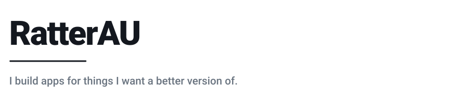
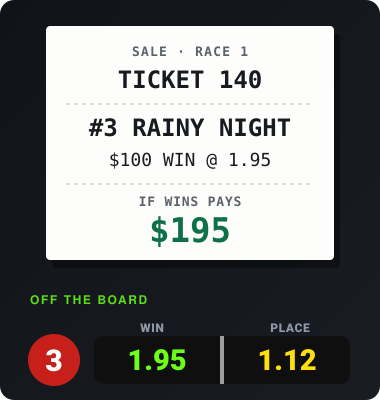

If the app doesn't exist, I make it. If it exists but does half of what I need, I make that too.

Swift and Kotlin, mostly. Everything here runs on the device, talks straight to the source, and keeps no account of you.

 

<table>
<tr>
<td width="200" valign="top">

</td>
<td valign="top">

### [Alembic](https://github.com/RatterAU/Alembic)

Any video, straight onto your iPhone. No computer, no cable, no dodgy websites.

Getting a video onto your phone usually means opening the laptop, fighting a downloader site full of ads and fake buttons for a file in whatever quality it felt like, then a cable, AirDrop or a round trip through the cloud. Ten minutes and two devices for one video. So I built the proper way: copy the link, paste it, tap Download, done.

It's the real yt-dlp running on the phone itself, with FFmpeg compiled in and YouTube's challenges solved in a locked-down WebKit page. Any quality, codec or container, audio only, a clip by time or chapter, whole playlists. Cover art, chapters and subtitles go into the file, and SponsorBlock cuts the sponsors out without re-encoding.

No accounts, no ads, no server. yt-dlp keeps itself current, from signature-checked official releases only.

[How to install](https://github.com/RatterAU/Alembic#install-it) · iPhone app, no App Store listing. Add my [LiveContainer source](https://ratterau.github.io/apps/) and install it from there.

`SwiftUI` · `Python 3.13` · `yt-dlp` · `FFmpeg` · `WebKit`

</td>
</tr>
<tr>
<td width="200" valign="top">

</td>
<td valign="top">

### [TENFOLD](https://github.com/RatterAU/tenfold)

Every SPX strike, in SPY terms — for 0DTE.

SPY is not SPX ÷ 10. The ratio drifts, and on 0DTE that drift is a whole strike, so the mirror runs off the live ratio instead of the shortcut everyone quotes.

Quote tiles, the live ratio, a depth picker and the strike ladder with the spot band. Opens in the browser: no install, no signup, no key.

[Try it here](https://ratterau.github.io/tenfold/) · one HTML file, no dependencies, no build step, no tracking.

`HTML` · `Vanilla JS` · `0DTE` · `SPX/SPY`

</td>
</tr>
<tr>
<td width="200" valign="top">

</td>
<td valign="top">

### [BASIS](https://github.com/RatterAU/basis)

What the position actually cost you, and what the next buy does to it.

Ten contracts at $1.00 and one at $2.00 is not a $1.50 average, it is $1.09 — which is the arithmetic people do in their head at the exact moment it matters most.

Fills go in, the weighted average comes out in money rather than points. Model the next buy before committing it, watch the curve flatten toward a price it can never reach, or ask it the inverse: how many at $0.55 to get the average to $0.80.

[Try it here](https://ratterau.github.io/basis/) · one HTML file, no dependencies, no build step, no tracking.

`HTML` · `Vanilla JS` · `Options` · `Cost basis`

</td>
</tr>
<tr>
<td width="200" valign="top">

</td>
<td valign="top">

### [Bookie](https://github.com/RatterAU/Bookie)

An on-course bookmaker's satchel, on a Mac.

Fielding a race meeting is a speed problem wearing a maths problem's clothes. The arithmetic is easy. Doing it while a punter is mid-sentence and eleven other people are holding cash is not.

So: stake, runner, one letter, and the docket prints on the keystroke. Price boards for up to four TVs, and settlement that never leaves a punter worse off than the paper in their hand.

[How to install](https://github.com/RatterAU/Bookie#install) · Mac app for macOS 14+. You build it yourself with Apple's free Command Line Tools, no Xcode needed.

`Swift` · `SwiftUI` · `SQLite` · `Combine` · `ESC/POS over USB`

</td>
</tr>
</table>
